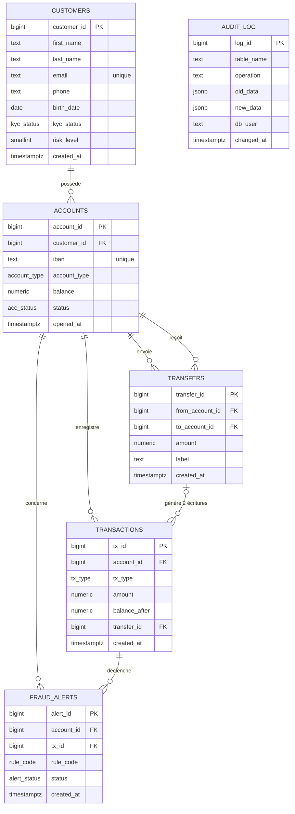

# NovaBank Core

Base de données PostgreSQL d'une banque en ligne, construite de zéro sur une VM Ubuntu Server :
installation du serveur, tables protégées, 1 000 000 d'écritures cohérentes, droits par métier,
vues, index, triggers, procédures, tests, sauvegarde et reconstruction automatique.

## Les trois problèmes du prototype, et leur réponse

| Problème | Réponse dans la base |
| --- | --- |
| Un employé a exporté tous les emails : il avait trop de droits | 4 profils au moindre privilège (E3) : personne ne lit `core.customers` ; le support passe par une vue qui masque emails, noms et téléphones (E4) |
| Deux virements simultanés ont donné un solde négatif | Procédure `core.sp_virement` (E7) : une seule transaction, comptes verrouillés dans l'ordre croissant (`FOR UPDATE`), solde vérifié par trigger (E6) et par contrainte (`ck_accounts_balance`) |
| L'historique d'un compte met plus de 4 secondes à s'afficher | Index `(account_id, created_at)` (E5) : relevé passé de 171 ms à 0,05 ms sur 1 000 000 d'écritures |

---

## Prérequis

- VirtualBox, VM **Ubuntu Server 26.04 LTS**, 2 Go de RAM, 2 processeurs
- **Deux cartes réseau** :
    - carte 1 en **NAT** : accès à Internet (`apt`)
    - carte 2 en **réseau privé hôte** (`192.168.56.0/24`) : accès depuis le PC (`ssh`, `psql`)
- Interface de paravirtualisation : **Par défaut / KVM** (voir « Problèmes rencontrés »)
- Adresse fixe de la VM : `192.168.56.10`, définie par netplan
  (`/etc/netplan/01-carte-reseau-privee-hote.yaml`, `dhcp4: false`, sans passerelle)
- Nom de la machine : `novab-db`, accès SSH par clé (`ssh novab-db`)

---

## Installation, dans l'ordre

Depuis le PC, à la racine du dépôt, envoyer les dossiers dans la VM :

```bash
scp -r SQL scripts novab-db:~/
```

Puis, dans la VM :

```bash
# 1. installer et configurer PostgreSQL 18, le pare-feu et pg_hba.conf
chmod 755 ~/scripts/*.sh
sudo ~/scripts/installation.sh

# 2. créer la base, les rôles, les tables, les données, les droits, les vues,
#    les index, les triggers et les procédures (demande OUI, puis les 5 mots de passe)
sudo ~/scripts/tout_refaire.sh

# 3. lancer les tests : 57 OK attendus, 0 KO
sudo -u postgres psql -d bankdb < ~/SQL/tests/tests.sql > ~/resultats_tests.txt 2>&1
grep -c 'RESULTAT: OK' ~/resultats_tests.txt
grep -c 'RESULTAT: KO' ~/resultats_tests.txt

# 4. sauvegarder la base et vérifier la sauvegarde
sudo ~/scripts/sauvegarde.sh
```

`tout_refaire.sh` peut être relancé à tout moment : il supprime la base et les rôles du projet,
puis reconstruit tout de zéro (environ 1 à 2 minutes, à cause du million d'écritures).

**Aucun mot de passe n'est stocké dans le dépôt** : ils sont saisis à la main avec `\password`
pendant `tout_refaire.sh`.

---

## Organisation des fichiers

```
captures/                 captures d'écran, par étape
scripts/
    installation.sh       installe et configure le serveur (E1)
    sauvegarde.sh         sauvegarde la base et vérifie la sauvegarde (E8)
    tout_refaire.sh       supprime et reconstruit la base de zéro (E8)
SQL/
    00_role_base.sql      rôle bank_owner, base bankdb                  (postgres)
    01_schemas_types.sql  schémas core et audit, types ENUM             (bank_owner)
    02_tables.sql         les 6 tables et leurs contraintes             (bank_owner)
    03_donnees.sql        1 000 000 d'écritures cohérentes              (bank_owner)
    04_postgre_role.sql   4 groupes, 4 comptes, timeout de l'analyste   (postgres)
    05_bank_owner_role.sql droits sur les schémas et les tables         (bank_owner)
    06_triggers.sql       grand livre immuable, audit, solde, fraude    (bank_owner)
    07_vues.sql           vue masquée, vue modifiable, vue enregistrée  (bank_owner)
    08_index.sql          4 index, mesures avant/après en commentaire   (bank_owner)
    09_procedures.sql     ouverture de compte, virement, relevé         (bank_owner)
    outils/compare.sql    comptage des lignes, utilisé par sauvegarde.sh
    tests/tests.sql       57 tests : un cas qui passe, un cas refusé par règle
.gitignore                .idea, .env, fichiers .dump…
.gitattributes            fins de ligne LF pour les .sh et les .sql
README.md
```

Les fichiers SQL sont **numérotés dans l'ordre d'exécution** : `tout_refaire.sh` les rejoue dans
cet ordre, chacun avec le bon utilisateur (`postgres` pour `00` et `04`, `bank_owner` pour les autres,
via `SET ROLE bank_owner`). Chaque fichier contient en commentaire ses commandes de vérification.

---

## Schéma des tables



Toutes les tables sont dans le schéma `core`, sauf `audit.audit_log`.

### Protections

| Table | Règle | Protection |
| --- | --- | --- |
| `core.customers` | Email unique et valide | `UNIQUE` + `ck_customers_email` (`LIKE '%@%.%'`) |
| `core.customers` | Client majeur | `ck_customers_majeur` (`age(birth_date) >= interval '18 years'`) |
| `core.customers` | Niveau de risque de 1 à 5 | `ck_customers_risk_level` |
| `core.accounts` | Solde jamais négatif | `ck_accounts_balance` + trigger du solde |
| `core.accounts` | IBAN unique | `UNIQUE` |
| `core.transfers` | Montant positif ; comptes différents | `ck_transfers_amount`, `ck_transfers_comptes_differents` |
| `core.transactions` | Signe cohérent avec le type (entrées positives, sorties négatives) | `ck_transactions_signe` |
| `core.transactions` | Jamais modifiée ni supprimée | Triggers `BEFORE UPDATE OR DELETE` et `BEFORE TRUNCATE` |
| `core.transactions` | Un virement = 2 écritures ou aucune | Procédure `core.sp_virement`, en une seule transaction |

Types `ENUM` (schéma `core`) : `kyc_status`, `account_type`, `acc_status`, `tx_type`, `alert_status`, `rule_code`.

---

## Rôles et droits

| Profil | Groupe (NOLOGIN) | Compte (LOGIN) |
| --- | --- | --- |
| Propriétaire des objets | — | `bank_owner` |
| Analyste | `grp_analyste` | `analyste_alice` |
| Support | `grp_support` | `support_bob` |
| Application | `grp_appli` | `app_novabank` |
| Auditeur | `grp_auditeur` | `auditeur_chloe` |

Les droits sont donnés aux **groupes** ; chaque compte en hérite (`INHERIT`).

| Profil | `USAGE` | Lecture | Exécution |
| --- | --- | --- | --- |
| Analyste | `core` | `accounts`, `transactions`, `transfers`, `fraud_alerts`, `mv_nb_tx_mois_type` | — |
| Support | `core` | `accounts`, `transactions`, `transfers`, `v_customers_support` | `fn_masquer_email` (exigé par la vue) |
| Application | `core` | **aucune table** | `sp_ouvrir_compte`, `sp_virement`, `fn_releve` |
| Auditeur | `core`, `audit` | `accounts`, `transactions`, `transfers`, `fraud_alerts`, `audit_log` | — |

- **Personne ne lit `core.customers`** directement.
- `CONNECT` sur `bankdb` retiré à `PUBLIC`, puis donné aux 4 groupes.
- `ALTER DEFAULT PRIVILEGES REVOKE EXECUTE ON FUNCTIONS FROM PUBLIC` : aucune nouvelle fonction n'est exécutable sans droit explicite.
- `analyste_alice` a un `statement_timeout` de 30 secondes. Ce réglage est posé **sur le compte**, car il ne s'hérite pas d'un groupe : un nouvel analyste devra recevoir le sien.
- Connexions (`pg_hba.conf`) : `postgres` en local (`peer`) ; `bank_owner` et l'appli depuis la VM seulement (`127.0.0.1`) ; analystes, support et auditeurs depuis le réseau d'administration (`192.168.56.0/24`) ; tout le reste est refusé (`reject`).

---

## Choix techniques, par étape

### E1 · Le serveur
- Installation par script Bash (`set -euo pipefail`, test root, fonction `log` colorée), **idempotent** : relançable sans erreur.
- Réglages dans `conf.d/01-novabank.conf` plutôt que dans `postgresql.conf` : fichier écrit en entier (`cat >`), facile à supprimer.
- `listen_addresses = '127.0.0.1, 192.168.56.10'`, `password_encryption = 'scram-sha-256'`, `log_connections = on`, `log_statement = 'ddl'`. `restart` nécessaire, car `listen_addresses` est en contexte `postmaster`.
- Pare-feu `ufw` : SSH autorisé **avant** l'activation, PostgreSQL ouvert au seul réseau `192.168.56.0/24`.
- `pg_hba.conf` réécrit en entier après une sauvegarde unique (`cp -p --update=none … .orig`), puis `reload`.

### E2 · Les tables et les données
- Montants en `numeric(14,2)` (valeurs exactes, contrairement à `float`), dates en `timestamptz`.
- Montants **signés** (sorties négatives) : `sum(amount)` donne directement le solde.
- Génération reproductible (`setseed`) : 100 000 clients, 200 000 comptes (2 par client, ~2 % gelés), 300 000 virements, 200 000 dépôts initiaux et 200 000 retraits, soit **1 000 000 d'écritures**.
- Chronologie sans chevauchement (client → compte + dépôt initial → mouvements de la dernière année) et montants choisis pour qu'aucun compte ne puisse passer sous 0.
- Écritures préparées dans une table temporaire (`UNION ALL`), puis insérées triées par date avec `balance_after` calculé par une **fonction de fenêtre** (`sum() OVER (PARTITION BY … ORDER BY … ROWS BETWEEN UNBOUNDED PRECEDING AND CURRENT ROW)`).
- Soldes des comptes = dernier `balance_after` (`DISTINCT ON`) ; requête de contrôle : **0 ligne** incohérente.
- Chargement dans une transaction, triggers désactivés (`DISABLE TRIGGER USER`) puis réactivés.

### E3 · Les droits
Trois portes : `CONNECT` sur la base, `USAGE` sur le schéma, droit sur l'objet. Preuves : `SET ROLE` et matrice `has_table_privilege` (`VALUES` × `CROSS JOIN`).

### E4 · Les vues
- `core.v_customers_support` (`security_barrier`) : prénom en clair, initiale du nom, email `c*******@novabank.bk`, téléphone `********42`, année de naissance seule, statut KYC ; niveau de risque absent.
- `core.v_comptes_ouverts` (`WITH LOCAL CHECK OPTION`) : comptes actifs ou gelés, **sans le solde** (sinon on pourrait le modifier sans passer par le grand livre) ; geler est permis, fermer est refusé. Accordée à aucun profil (moindre privilège).
- `core.mv_nb_tx_mois_type` (vue enregistrée) : nombre et total des écritures par mois et par type ; index unique exigé par `REFRESH … CONCURRENTLY`.

### E5 · Les index

| Requête | Index | Avant | Après |
| --- | --- | --- | --- |
| Relevé d'un compte trié par date | B-tree `(account_id, created_at)` | Seq Scan, ~10 000 pages, 171 ms | 7 pages, **0,05 ms** |
| Recherche d'email insensible à la casse | Sur l'expression `lower(email)` | Seq Scan, ~1 300 pages, 99 ms | 4 pages, **0,06 ms** |
| Comptes gelés (~2 %) | Partiel, `WHERE status = 'FROZEN'` | Seq Scan, ~4 740 pages, 252 ms | **25 ms** |
| Somme sur un mois | `BRIN (created_at)` | Seq Scan, ~9 940 pages, 170 ms | **61 ms**, index de 24 kB (contre 30 Mo pour un B-tree) |

- Recherche faite sur l'email plutôt que sur le nom : les données de test ne comptent que 20 noms différents.
- Le `BRIN` fonctionne car le grand livre est rangé dans l'ordre chronologique (insertion triée par date).
- **Index inutile** : un index complet sur `status` (1 368 kB, contre 104 kB pour le partiel) est **ignoré** par PostgreSQL pour les comptes actifs (98 % des lignes). Créé pour la démonstration, puis supprimé.
- Index créés **après** le chargement des données (fichier `08`), ce qui est plus rapide.

### E6 · Les triggers
- **Grand livre immuable** : `UPDATE`, `DELETE` et `TRUNCATE` (trigger `FOR EACH STATEMENT`) refusés, même pour le propriétaire.
- **Solde** (`BEFORE INSERT`) : lit le solde avec `FOR UPDATE`, refuse s'il deviendrait négatif, remplit `balance_after` et met à jour le compte. Le chargement initial calcule les soldes par fonction de fenêtre (plus rapide), le trigger gère les écritures suivantes.
- **Fraude** (`AFTER INSERT`) : alerte `BIG_WITHDRAWAL` pour un retrait de 5 000 € ou plus ; alerte `RAPID_TRANSFERS` à partir du 5e virement émis en 10 minutes.
- **Audit** générique (`TG_TABLE_SCHEMA`, `TG_TABLE_NAME`, `TG_OP`, `to_jsonb`) : clients (toute modification), comptes (changement de statut uniquement, via `WHEN`), alertes (modification).

### E7 · Les procédures
- `SECURITY DEFINER` avec `search_path` fixé : l'application agit **uniquement** à travers les procédures, sans aucun droit sur les tables.
- `core.sp_ouvrir_compte` : vérifie le client et son KYC, crée le compte (IBAN par la séquence `core.seq_iban`) et le dépôt initial.
- `core.sp_virement` : vérifie montant, comptes et statuts ; verrouille les deux comptes **dans l'ordre croissant** pour éviter l'interblocage ; écrit la demande et ses 2 écritures. Le solde est vérifié par le trigger : en cas d'échec, tout est annulé.
- `core.fn_releve` : écrite comme une **fonction** (`RETURNS TABLE`), car une procédure ne renvoie pas de lignes ; `LEFT JOIN` pour garder dépôts et retraits sans virement.

### E8 · Tests, sauvegarde, reconstruction
- **Tests** (`SQL/tests/tests.sql`) : 57 tests, chacun dans un `BEGIN … ROLLBACK` (rien n'est conservé), résultat lu avec `:ERROR`. Contrôle de contenu par division par zéro (`1 / count(*)`). Chaque refus est vérifié par son message (la bonne contrainte).
- **Sauvegarde** (`scripts/sauvegarde.sh`) : `pg_dump -Fc` daté dans `/var/backups/postgresql/` (droits `700`), restauration dans une base temporaire, comparaison des comptages avec `compare.sql`, puis suppression de la base temporaire. Les rôles ne sont pas inclus dans `pg_dump` : ils sont recréés par `04_postgre_role.sql`.
- **Reconstruction** (`scripts/tout_refaire.sh`) : confirmation `OUI`, suppression de la base (`--force`) puis des 9 rôles listés explicitement, rejeu des fichiers numérotés, puis saisie des mots de passe (redemandée tant que les deux saisies diffèrent).

---

## Problèmes rencontrés

- **Installation bloquée** sur *Loading essential drivers* : interface de paravirtualisation passée à « Aucune » pour l'installateur.
- **Horloge de la VM en avance de 2 jours** (dates d'audit dans le futur), conséquence du point précédent : `chronyc tracking` montrait 179 151 s d'avance et une dérive de 500 000 ppm. Paravirtualisation réactivée (le système installé démarre), horloge `kvm-clock`, `sudo chronyc makestep`, puis données régénérées.
- **Sauvegarde déclarée invalide** alors que les comptages étaient identiques : l'ordre des lignes d'un `UNION ALL` n'est pas garanti. Ajout d'un `ORDER BY` dans `compare.sql`.

---

## Captures

| Fichier | Ce qu'il prouve |
| --- | --- |
| `E0-ssh.png` | Connexion SSH par clé, invite `r-adm@novab-db` |
| `E0-ip.png` | Adresse fixe `192.168.56.10` sur la carte host-only |
| `E1-installation.png` | Script d'installation jusqu'au bout, idempotent |
| `E1-service.png` | PostgreSQL 18, port 5432, `online` |
| `E1-listen_addresses.png` | Adresses d'écoute appliquées |
| `E1-ufw.png` | Règles du pare-feu |
| `E1-pg_hba_file_rules.png` | 5 règles, aucune erreur |
| `E1-connexion-refusee.png` | Connexion interdite refusée et retrouvée dans le journal |
| `E2-roles-base.png` | `bank_owner` sans attribut spécial, propriétaire de `bankdb` |
| `E2-schemas-types.png` | Schémas et types `ENUM` |
| `E2-tables_&_check-refuse.png` | Les 6 tables et le client mineur refusé |
| `E2-releve-compte.png` | Soldes cumulés d'un compte |
| `E2-donnees.png` | 1 000 000 d'écritures, contrôle à 0 ligne |
| `E3-roles.png` | Groupes et comptes (`\du`, `\drg`) |
| `E3-set-role.png` | Lecture des comptes permise, des clients refusée |
| `E3-matrice.png` | Matrice `has_table_privilege` |
| `E3-timeout.png` | Timeout pour l'analyste_alice |
| `E4-vue-masquee.png` | Vue du support, données masquées |
| `E4-vue-modifiable.png` | Fermeture refusée par la `CHECK OPTION` |
| `E4-vue-enregistree.png` | Vue figée avant `REFRESH`, à jour après |
| `E5-*-avant.png` / `E5-*-apres.png` | Mesures `EXPLAIN` de chaque index |
| `E5-index-inutile.png` | Index complet ignoré, tailles comparées |
| `E5-usage-index.png` | `pg_stat_user_indexes` |
| `E6-immuable.png` | `UPDATE`, `DELETE`, `TRUNCATE` refusés |
| `E6-audit.png` | Gel et dégel audités |
| `E6-solde.png` | Solde mis à jour, retrait excessif refusé |
| `E6-fraude.png` | Alertes `BIG_WITHDRAWAL` et `RAPID_TRANSFERS` |
| `E7-ouverture.png` | Ouverture de compte par l'appli, refus |
| `E7-virement.png` | Virement réussi, refus, tout ou rien |
| `E7-releve.png` | Relevé d'un compte |
| `E8-sauvegarde.png` | Sauvegarde vérifiée |
| `E8-tout-refaire-debut.png` / `E8-tout-refaire-fin.png` | Reconstruction complète |
| `E8-reconstruction-verif.png` | Base reconstruite fonctionnelle |
| `E8-tests-bilan.png` | 57 OK, 0 KO |
| `E8-tests-erreurs.png` | Chaque refus vient de la bonne règle |

---

## Usage de l'IA

Le projet a été réalisé avec l'aide de **Claude** (Anthropic), utilisé comme tuteur :

- **Explications et questions** : mini-cours sur chaque notion (réseau VirtualBox, SSH, Bash, PostgreSQL, PL/pgSQL), questions pour guider le raisonnement plutôt que des réponses toutes faites.
- **Relecture** : chaque fichier a été écrit par moi, puis relu par l'IA, qui signalait les erreurs ; je les ai corrigées.
- **Code fourni par l'IA**, puis compris, adapté et testé :
    - la fonction `core.fn_solde` (trigger du solde) ;
    - des squelettes à trous : procédures d'ouverture, de virement et de relevé, trigger de fraude ;
    - certaines requêtes : matrice `has_table_privilege`, sous-requête de tirage des virements, astuce de la division par zéro dans les tests ;
    - la rédaction de ce README, à partir de mon journal de bord, relu et complété par moi.

Je suis en mesure d'expliquer chaque ligne du projet.